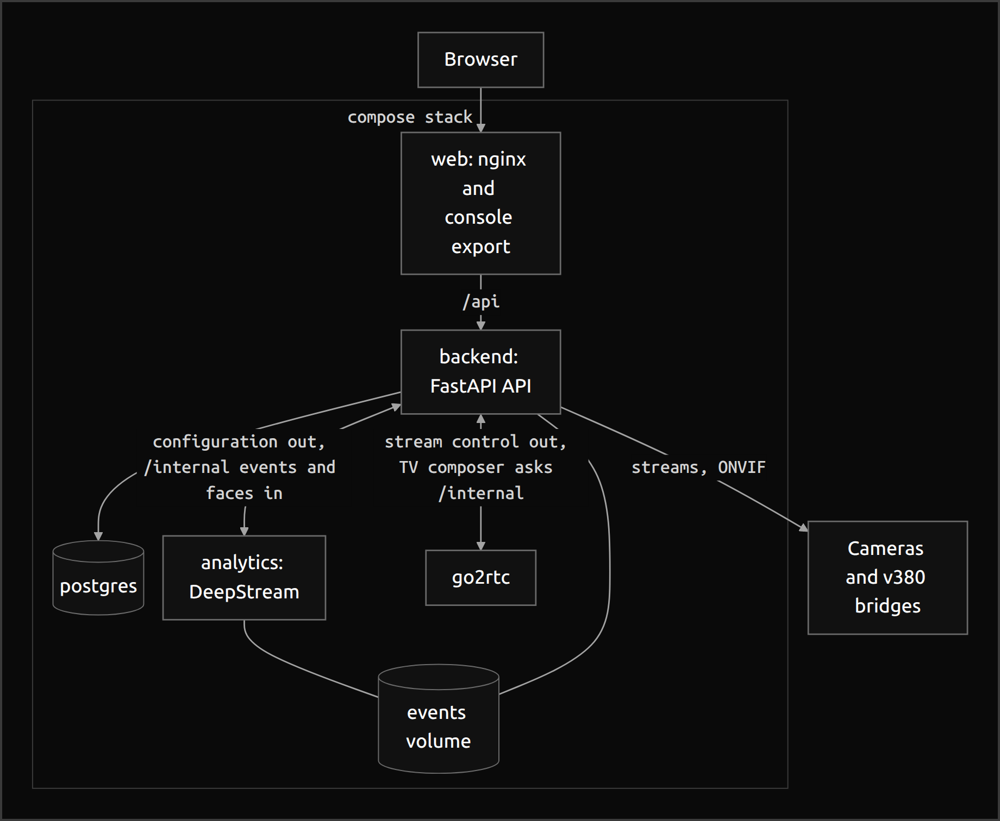
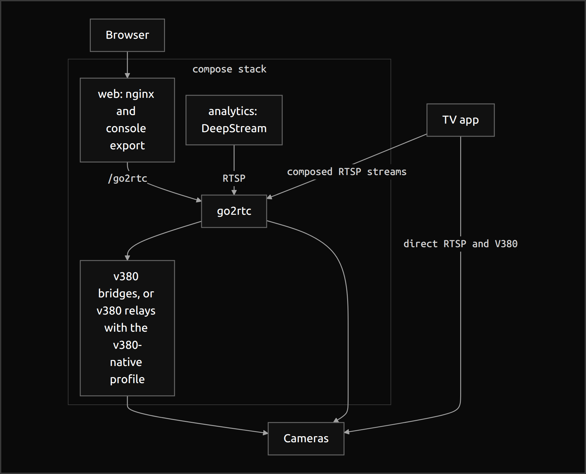

# Architecture

Smart Surveillance System is a monorepo of products, services and packages around one platform API. The root README describes the product; this document describes how the code is organised.

## Product map

| Area | Folder | Role |
|---|---|---|
| App | apps/console | Next.js web console: wall, camera pages, events, people, counts, health and administration |
| App | apps/tv | Android TV wall app that plays the cameras on a TV |
| Service | services/api | FastAPI platform API and the only writer of the database |
| Service | services/connector | Site agent: pairing, LAN discovery, camera credentials and a go2rtc restream for central |
| Service | services/analytics | DeepStream analytics engine: detection, tracking, rules, faces, plates, recordings |
| Service | services/v380-bridge | Pinned upstream decoder that republishes a V380 camera as RTSP and ONVIF, until the cut-over to the relay |
| Service | services/v380-relay | Serves one V380 camera over RTSP with our own V380 client and takes its controls over HTTP |
| Package | packages/camera-adapters | Python package camera_adapters: one adapter per kind of camera behind one interface |
| Package | packages/contracts | The generated OpenAPI document of the API |
| Deploy | deploy | One folder per deployment target, server, central, connector, jetson and devkit, each with one docker-compose.yml and its go2rtc configuration |
| Tools | tools/devkit | Simulated site for development: IP cameras, V380 cameras, seed data |
| Tools | tools/cv-viewer | OpenCV viewer of the cameras |
| Scripts | scripts | Shell scripts: model downloads and the OpenAPI export |

Each deployment target runs from its own folder in deploy, as deploy/README.md describes. The Python services and packages form one uv workspace with one uv.lock.

## Business domains

The API keeps one folder per domain in services/api/app/modules, each with models, schemas, services, routers and deps.

| Domain | Owns |
|---|---|
| identity | Users, sessions, tokens, verification, account deletion |
| tenancy | Organisations, sites, memberships, roles, invitations |
| devices | Connectors, devices and channels, cameras, pairing, discovery, capability manifests, camera control |
| media | Live WebRTC signalling, snapshots, clips, replay |
| analytics | Views, zones, lines, areas, rules, profiles and the internal configuration and event intake of the engine |
| events | Event store, live stream, acknowledgement, retention |
| alerting | Arm modes, schedules, notification channels and dispatch |
| investigation | Search, people and faces, plates, appearances, journeys |
| insights | Counts, occupancy, reports |
| operations | Platform administration, audit log, system health, floor plans |
| tv | The PC-side TV pairing and stream composition |

Billing arrives later as its own domain. Engines and integrations that are not CRUD domains stay at the top of services/api/app: the go2rtc client in streaming, the ONVIF event subscriber in camera_events, health probing, the analytics client, and the background prune and rollup jobs. core, auth and models hold the shared base.

## System context

## Containers

The first diagram shows the requests between the containers, the second the video between them, the cameras and the TV app.

## Dependency rules

- Routers call services, and services own the transactions; routers import neither sqlalchemy nor the database module.
- A domain reaches another domain only through that domain's services, schemas or deps, never its models or routers.
- core and auth import no domain, no router layer and no application entry point.
- packages import nothing from services or apps; camera_adapters never imports app.
- Apps reach the API only over HTTP, and the OpenAPI document in packages/contracts is their contract.

services/api/pyproject.toml enforces the Python rules with import-linter contracts, and services/api/tests/test_architecture.py runs them as part of the API suite.
