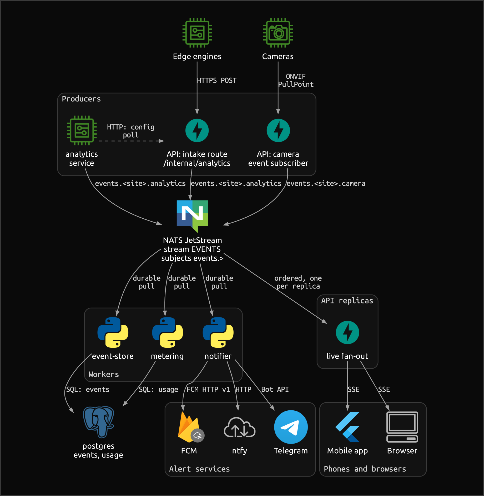
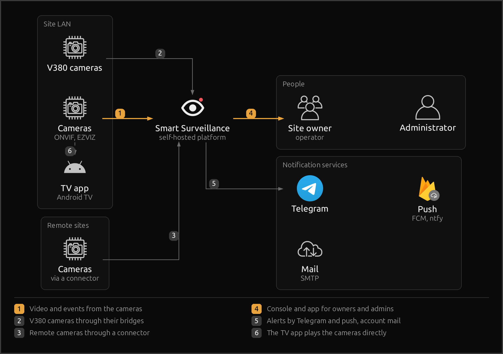

# Architecture

Smart Surveillance System is a monorepo of products, services and packages around one platform API. The root README describes the product; this document describes how the code is organised.

## Product map

| Area | Folder | Role |
|---|---|---|
| App | apps/console | Next.js web console: wall, camera pages, events, people, counts, health and administration |
| App | apps/tv | Android TV wall app that plays the cameras on a TV |
| Service | services/api | FastAPI platform API and its workers, event-store, notifier and metering, which run from the same image as their own containers; together the only writers of the database |
| Service | services/connector | Site agent: pairing, LAN discovery, camera credentials and a go2rtc restream for central |
| Service | services/analytics | DeepStream analytics engine: detection, tracking, rules, faces, plates, recordings |
| Service | services/v380-bridge | Pinned upstream decoder that republishes a V380 camera as RTSP and ONVIF, until the cut-over to the relay |
| Service | services/v380-relay | Serves one V380 camera over RTSP with our own V380 client and takes its controls over HTTP |
| Package | packages/camera-adapters | Python package camera_adapters: one adapter per kind of camera behind one interface |
| Package | packages/event-bus | Python package event_bus: the CloudEvents envelope, subjects, streams, publisher, consumer runner and an in-memory bus, over NATS JetStream |
| Package | packages/contracts | The generated OpenAPI document of the API and the JSON Schemas of the event types |
| Deploy | deploy | One folder per deployment target, server, central, connector, jetson and devkit, each with one docker-compose.yml and its go2rtc configuration |
| Tools | tools/devkit | Simulated site for development: IP cameras, V380 cameras, seed data |
| Tools | tools/cv-viewer | OpenCV viewer of the cameras |
| Scripts | scripts | Shell scripts: model downloads and the OpenAPI export |

Each deployment target runs from its own folder in deploy, as deploy/README.md describes. The Python services and packages form one uv workspace with one uv.lock.

## Business domains

The API keeps one folder per domain in services/api/app/modules, each with models, schemas, services, routers and deps.

| Domain | Owns |
|---|---|
| identity | Users, sessions, tokens, verification, account deletion |
| tenancy | Organisations, sites, memberships, roles, invitations |
| devices | Connectors, devices and channels, cameras, pairing, discovery, capability manifests, camera control |
| media | Live WebRTC signalling, snapshots, clips, replay |
| analytics | Views, zones, lines, areas, rules, profiles and the internal configuration and event intake of the engine |
| events | Event store, which the event-store worker runs, live stream, acknowledgement, retention |
| alerting | Arm modes, schedules, notification channels and the dispatch the notifier worker runs |
| investigation | Search, people and faces, plates, appearances, journeys |
| insights | Counts, occupancy, reports |
| operations | Platform administration, audit log, system health, floor plans |
| tv | The PC-side TV pairing and stream composition |

Billing arrives later as its own domain. Engines and integrations that are not CRUD domains stay at the top of services/api/app: the go2rtc client in streaming, the ONVIF event subscriber in camera_events, the bus connection and the live relay in bus, the workers in workers, health probing, the analytics client, and the background prune and rollup jobs. core, auth and models hold the shared base.

## Event pipeline

Every event travels on one message bus, NATS with JetStream, so the API can run as several replicas beside several analytics engines and workers, and a restart of any of them loses nothing in flight. Producers and consumers depend only on the Bus interface of packages/event-bus, which a Kafka adapter could implement for a very large central data platform without changing either.

- Producers publish event changes, each a CloudEvents 1.0 envelope that carries the whole event: the analytics engine on sss.organisation.site.analytics.view.event, and the API's ONVIF subscriber on sss.organisation.site.camera.camera.event. An engine that posts to the internal intake route has its changes published there by the API, so the bus is the only way into the pipeline. The configuration poll stays a request and response over HTTP.
- The event-store worker reads the SSS_EVENTS stream through a durable consumer and upserts each change by the event's id, so a change delivered twice, or a later one before an earlier one, leaves the same event. It then sends the stored event to sss.organisation.site.live and, the first time an event alerts, an alert to sss.organisation.alert whose id derives from the event, so the SSS_ALERTS stream keeps one per event.
- The notifier worker runs one durable consumer per channel, Telegram and push. A recipient that fails in a way a retry may cure brings the alert back after a backoff, the recipients that already received it are skipped, and the notifications sent go to sss.organisation.usage, which the metering worker adds to the hourly rollups beside the hourly gauge rollup it also runs.
- Every API replica runs a live relay: it listens to the live fan-out, which no stream stores, and passes each message to the server-sent event clients connected to that replica, and it follows the last observation of every view. After a reconnect to the bus the relay tells its clients to reconnect, which hands them the current state.
- A consumer that fails delays the message by its backoff and, after its last attempt, writes it with the reason to sss.deadletter.stream.consumer. Producers retry a few times and then keep up to 2000 messages in order in memory until the bus answers again.

packages/event-bus/README.md lists every subject, stream, limit and consumer with the reasons for them.

## System context

## Containers

The first diagram shows the requests between the containers, the second the video between them, the cameras and the TV app.

## Dependency rules

- Routers call services, and services own the transactions; routers import neither sqlalchemy nor the database module.
- A domain reaches another domain only through that domain's services, schemas or deps, never its models or routers.
- core and auth import no domain, no router layer and no application entry point.
- packages import nothing from services or apps; camera_adapters and event_bus never import app, and event_bus imports nothing but its NATS client.
- Nothing in the product imports the workers; a worker only wires services of the domains to durable consumers.
- Apps reach the API only over HTTP, and the OpenAPI document in packages/contracts is their contract.

services/api/pyproject.toml enforces the Python rules with import-linter contracts, and services/api/tests/test_architecture.py runs them as part of the API suite.
